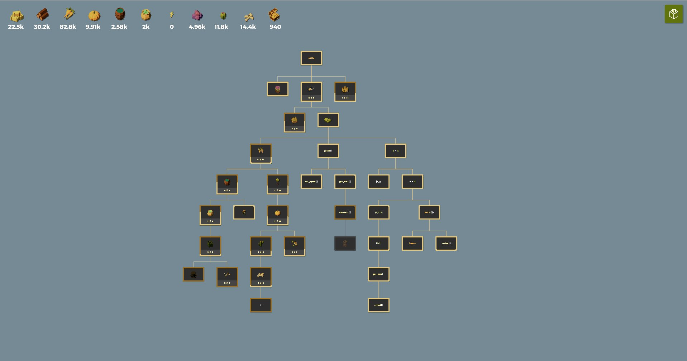
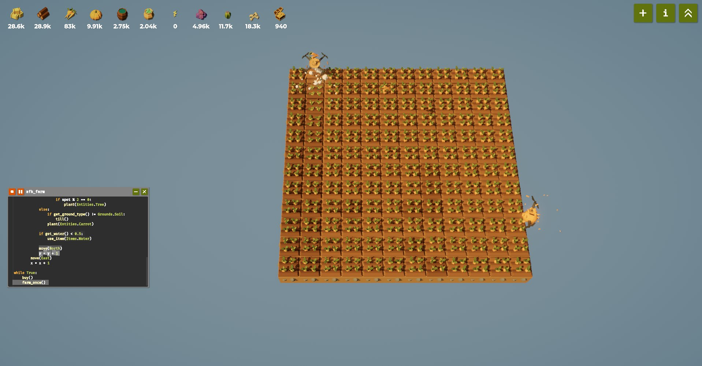

# Farmer Was Replaced — лабораторная работа 3–4

Учебный скрипт для игры **The Farmer Was Replaced**. Он открывает доступные улучшения и повторяет цикл обработки поля: собирает готовые культуры, наращивает запасы сена и дерева, затем переключается на морковь. Поле обходится по клеткам; при необходимости используется вода.

## Скриншоты





## Запуск

Скрипт использует API и перечисления, предоставляемые игровым окружением (`unlock`, `move`, `plant`, `Items`, `Entities` и другие). Это не обычный Python-модуль: запускать код следует в редакторе игры **The Farmer Was Replaced**.

Логика рассчитана на непрерывную работу и содержит бесконечный цикл `while True`. Останавливайте её средствами игрового редактора, когда потребуется.

## Скрипт

```python
def buy():
    unlock(Unlocks.Speed)
    unlock(Unlocks.Expand)
    unlock(Unlocks.Plant)
    unlock(Unlocks.Grass)
    unlock(Unlocks.Watering)
    unlock(Unlocks.Trees)
    unlock(Unlocks.Carrots)
    unlock(Unlocks.Pumpkins)
    unlock(Unlocks.Fertilizer)
    unlock(Unlocks.Sunflowers)
    unlock(Unlocks.Cactus)
    unlock(Unlocks.Mazes)
    unlock(Unlocks.Polyculture)
    unlock(Unlocks.Dinosaurs)
    unlock(Unlocks.Megafarm)
    unlock(Unlocks.Hats)
    unlock(Unlocks.Debug)
    unlock(Unlocks.Debug_2)


def farm_once():
    size = get_world_size()
    buffer = size * size
    if buffer < 100:
        buffer = 100

    x = 0
    while x < size:
        y = 0
        while y < size:
            if can_harvest():
                harvest()

            hay = num_items(Items.Hay)
            wood = num_items(Items.Wood)
            spot = get_pos_x() + get_pos_y()

            if hay < buffer or wood < buffer:
                if hay <= wood:
                    if get_ground_type() != Grounds.Grassland:
                        till()
                else:
                    if get_ground_type() != Grounds.Grassland:
                        till()
                    if spot % 2 == 0:
                        plant(Entities.Tree)
            else:
                if get_ground_type() != Grounds.Soil:
                    till()
                plant(Entities.Carrot)

            if get_water() < 0.5:
                use_item(Items.Water)

            move(North)
            y = y + 1
        move(East)
        x = x + 1


while True:
    buy()
    farm_once()
```

## Логика

- Открывает улучшения и игровые механики.
- Обходит поле и собирает урожай, если он готов.
- Поддерживает запасы сена и дерева; для дерева использует часть клеток.
- При достаточных запасах сажает морковь.
- Поливает клетку при низком уровне воды.
